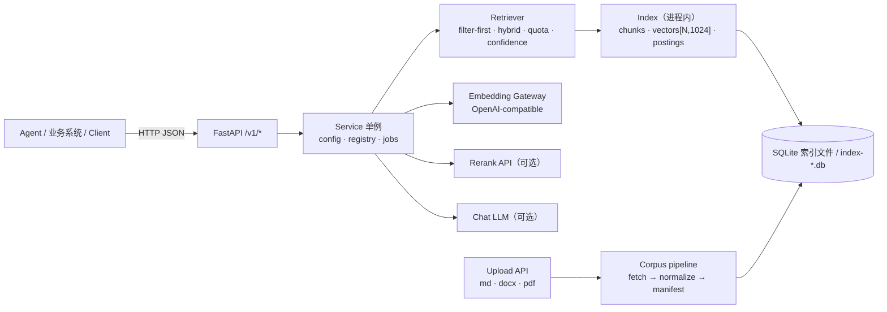
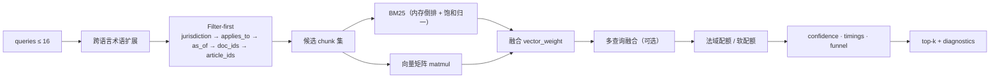
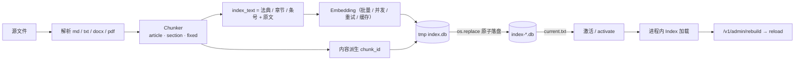

# Mercatoria · 跨境贸易法规检索后端 / Cross-border Trade Law Retrieval Backend

> **基于 RAGFlow 的后端实现**：沿用 RAGFlow `laws` 解析器的分块契约与知识库导入约定，
> 检索、过滤、重排、引用与问答由本服务实现，可独立部署，也可作为 RAGFlow 生态的检索后端。
>
> **A RAGFlow-based backend implementation**: keeps RAGFlow's `laws` chunking contract and
> knowledge-base import conventions, and provides retrieval, filtering, reranking, citation
> and answer generation as a standalone service.

`Python 3.11` · `FastAPI` · `SQLite` · `NumPy` · `CPU-only` · `deterministic chunk ids`

**中文** · [English](#english-documentation)

---

## 架构图 / Architecture

**图 1 · 系统架构 / System architecture**



**图 2 · 检索流水线 / Retrieval pipeline**



**图 3 · 索引生命周期 / Index lifecycle**



---

# 中文文档

## 1. 定位

Mercatoria 是面向跨境贸易合规场景的**法条级检索后端**：输入一句自然语言问题，输出可引用的
法规原文片段、完整法条、交叉引用与低置信提示。它的设计目标按优先级排列：

1. **可引用**：返回的 `text` 是法规原文，`chunk_id` 由内容派生，同一段法律文本在任何一次重建中
   都得到相同的 id，引用可复核、可回归。
2. **可解释**：每次请求都附带 `diagnostics.funnel`、`zero_reason`、`score_parts`、
   `matched_terms`、`timings_ms`，能回答“为什么召回 / 为什么没召回 / 慢在哪”。
3. **可运营**：配置热更新即失效缓存、索引多版本原子切换、上传/删除/重建是异步 job、
   schema 版本化并兼容旧库。
4. **零 GPU**：embedding 走外部 OpenAI 兼容网关，检索侧是 NumPy + 内存倒排，
   单机 CPU 即可稳定服务。

## 2. 架构总览

| 层 | 组成 | 职责 |
|---|---|---|
| 接入层 | FastAPI（`mercatoria/api.py`） | 路由、参数校验、错误码；同步检索 + 异步 job |
| 服务层 | `Service`（单例） | 配置热更新、索引 reload、文档注册表、job 锁 |
| 检索层 | `Retriever`（`mercatoria/retrieve.py`） | 查询扩展、过滤漏斗、混合打分、配额、置信度、缓存 |
| 索引层 | `Index`（`mercatoria/store.py`） | 内存倒排 + 向量矩阵 + 条文聚合 + 交叉引用；启动后关闭 SQLite 连接 |
| 语料层 | `corpus/fetch_*.py`、`manifest.py`、`normalize_cn_corpus.py` | 抓取、规整、生成 `manifest.json` |
| 评测层 | `tools/*.py`、`tests/*` | 消融、hold-out、覆盖率、profile、并发压测、fixture 审计 |

**规模**：143 篇法规 / 11,562 个 chunk / 8,191 个条文；向量 11,562 × 1024（float32，约 45 MB）。
索引加载约 **1.7 s**，单次本地检索 p50 **28 ms**，缓存命中 p50 **0.24 ms**。

## 3. 检索流水线（每一步都可见）

1. **查询扩展**：中文问题按 224 条中英日贸易术语表追加等价表述（182 中→英、42 中→日）。
2. **Filter-first**：`jurisdictions → applies_to → as_of → doc_ids → article_ids` 依次收窄候选，
   每一步数量写入 `diagnostics.funnel`；空集时给出精确 `zero_reason`。
3. **双路召回**：BM25（内存倒排，饱和归一，避免低 IDF 巧合压过向量）与向量（矩阵乘）；
   两路按 `retrieval.vector_weight` 融合。
4. **多查询融合**：`queries` 可传多路（≤16），同一 chunk 被多路命中时可加分（默认关闭）。
5. **法域配额**：请求多个法域时，为每个法域保留 `min(2, top_k // n)` 个槽位，防止单一法域霸榜；
   可指定 `per_jurisdiction_k`，也可用 `quota_min_ratio` 做软配额。
6. **置信度**：`high / medium / low`，由 top-1 余弦与查询词的 IDF 加权覆盖率合成，
   **不改变** `chunks` 的内容与顺序，供下游决定是否降级或拒答。
7. **观测字段**：`timings_ms`（filter/embed/bm25/vector/rank/total）、`embedding_cache_hits`、
   `degraded`、`warnings`、`quota_slots`。

## 4. 索引与写入

- **Chunk id 内容派生**：`sha256(doc_id + "\x1f" + article_id + "\x1f" + normalize(text))[:16]`。
  `text` 恒为原文，重建稳定（有单测锁定）。
- **索引文本与原文解耦**：embedding 与 BM25 使用 `[法典 | 章节 | 条号]\n原文`，
  返回值只给原文；`chunks.token_count` 记原文长度，`chunks.index_token_count` 供 BM25 归一化。
- **向量复用**：重建时按每个 chunk 的 `index_text` 哈希逐条校验，只有完全相同的文本才复用向量，
  避免“改了法典名但 chunk_id 没变”导致的脏向量。
- **原子发布**：新索引写入 `index-<ts>-<hash>.db.tmp`，`os.replace` 落盘，
  再写 `current.txt` 激活；服务 `reload()` 失败不影响旧索引。
- **Schema 版本**：`meta.schema_version = 2`；旧库自动回退（缺列补默认），
  新库打开时返回 503 并提示重建。

## 5. 设计要义

| 设计决策 | 为什么 | 可验证的证据 |
|---|---|---|
| 内容派生 `chunk_id` | 引用可复现、重建可比对、缓存可复用 | `test_chunk_ids_are_stable_across_rebuild` |
| `index_text` 与 `text` 解耦 | 章节/法典名进入向量与 BM25，但返回仍是原文 | 消融 A2：真题 Hit@5 −1.7pp（关闭 header 时） |
| Filter-first + 漏斗诊断 | 无命中时能证明是过滤空还是打分弱 | `zero_reason ∈ {no_jurisdiction, no_doc, no_article, no_match…}` |
| 内存倒排 + 关闭连接 | 消除跨线程 SQLite 竞争；查询路径零 SQL | BM25 p50 2.3 ms；连接关闭单测 |
| 查询向量 LRU + 持久化缓存 | 重复问题不打扰网关；线程安全 | 缓存命中 p50 0.24 ms；并发单测 |
| 法域配额先扩池再截断 | 配额只有在候选池够宽时才有效 | 覆盖率 1/8 → 8/8 |
| 置信度只读不改结果 | 下游需要“是否该拒答”，但不应被改写候选 | 真题 no_answer 低置信率 0.83 |
| 评测与算法分提交 | 指标可归因 | A0/A1 消融：判分口径占 +2.04pp |
| schema 版本化 | 灰度重建期间新旧索引并存 | 旧库回退 + 新库 503 单测 |

## 6. 快速开始

```bash
python -m venv .venv
.venv/Scripts/pip install -r requirements.txt      # Windows
# .venv/bin/pip install -r requirements.txt        # POSIX

# 1) 抓取/整理语料（可选，需要网络）
bash scripts/setup-corpus.sh

# 2) 生成 manifest（从 corpus/ 目录推导 doc_id 与元数据）
python -m mercatoria.cli manifest

# 3) 建索引（调用 embedding 网关；结束自动激活）
python -m mercatoria.cli rebuild

# 4) 启动服务
python -m mercatoria.cli serve --host 127.0.0.1 --port 8080
```

配置来源优先级：显式 `--config` > 仓库根 `config.json` > 内置默认值；密钥/端点可用环境变量覆盖
（见第 8 节）。Docker 见根目录 `docker-compose.test.yml`。

## 7. HTTP 接口参考

### 7.1 通用约定

- 所有请求与响应均为 JSON（上传接口为 `multipart/form-data`）。字符集 UTF-8。
- 时间一律 `YYYY-MM-DD`；字符串比较为大小写不敏感（法域自动大写化）。
- 错误体：`{"detail": "..."}`（FastAPI 默认），或 503 的 `{"error": "...", "corpus": {...}}`。
- 无内建鉴权：生产环境请置于网关/反向代理之后。

### 7.2 端点总表

| 方法 | 路径 | 说明 |
|---|---|---|
| GET | `/health` | 健康、活动索引、schema、配置摘要 |
| GET / PUT | `/v1/config` | 读取 / 热更新配置 |
| POST | `/retrieve`、`/v1/retrieve` | 纯检索 |
| GET | `/v1/articles/{article_id}` | 完整法条 + 邻条 + 交叉引用 |
| POST | `/v1/articles/batch` | 批量取法条（≤32） |
| POST | `/chat`、`/v1/chat`、`/ask`、`/v1/ask` | 检索 + 可选生成（带引用） |
| POST | `/v1/documents` | 批量上传并异步入库 |
| GET | `/v1/documents` | 文档列表（可按 status 过滤） |
| GET | `/v1/documents/{doc_id}` | 文档详情 |
| PATCH | `/v1/documents/{doc_id}` | 修改元数据并重建 |
| DELETE | `/v1/documents/{doc_id}` | 删除并重建 |
| POST | `/v1/documents/{doc_id}/reindex` | 单文档重解析/重索引 |
| GET | `/v1/documents/{doc_id}/chunks` | 分页查看该文档的 chunk |
| POST | `/v1/admin/manifest` | 从语料目录重建 manifest |
| POST | `/v1/admin/rebuild` | 重建索引（可后台、可同步冒烟） |
| GET | `/v1/jobs/{job_id}` | 任意 job 状态 |
| GET | `/v1/admin/rebuild/{job_id}` | 同上（别名） |
| POST | `/v1/admin/activate/{version}` | 切换活动索引 |
| GET | `/v1/admin/indexes` | 列出索引文件与当前活动版本 |
| GET | `/` | 服务名与端点清单 |

### 7.3 `GET /health`

成功（200）：

```json
{
  "status": "ready",
  "pending_rebuild": false,
  "index": {
    "version": "20261113-112706-384123-72d4a2df2417",
    "chunks": 11562,
    "documents": 143,
    "embedding_model": "my-team-2k/qwen3.7-text-embedding",
    "chunking_hash": "72d4a2df2417",
    "built_at": "2026-11-13T03:27:19+00:00",
    "schema_version": 2,
    "index_schema_outdated": false
  },
  "config": { "retrieval": {"top_k": 5}, "rerank": {"enabled": false} }
}
```

503：`{"status": "not_built" | "empty", "error": "...", "corpus": {...}?}`。

### 7.4 `GET|PUT /v1/config`

`GET` → `{"config": {...}, "active_index": "...", "pending_rebuild": false}`。

`PUT` 请求体为**部分更新**：只传要改的 section/key，未知 key 忽略；`"save": true` 时写入
`config.json`。修改 `chunking`/`embedding` 会置 `pending_rebuild=true`；任何修改都会同步
`rerank_enabled` 并清空检索缓存。

```json
{
  "retrieval": {"top_k": 8, "query_stopwords": true, "confidence": {"medium": 0.6}},
  "rerank": {"enabled": true, "candidates": 20},
  "save": false
}
```

### 7.5 `POST /v1/retrieve`

请求字段：

| 字段 | 类型 | 默认 | 说明 |
|---|---|---|---|
| `queries` | `string[]` 或 `string` | — | 1–16 条；也接受 `question` |
| `top_k` | int | 配置 `retrieval.top_k` | 1–100 |
| `filters` | object | `{}` | 见下表 |
| `fields` | object | `{}` | 兼容字段，见下 |
| `rerank` | bool | 服务端 `rerank.enabled` | 单请求开关 |
| `per_jurisdiction_k` | int | 无 | 0–100；0 表示关闭配额 |

`filters` 明细：

| key | 类型 | 语义 |
|---|---|---|
| `jurisdictions` | `string[]` | 法域集合（交集），如 `["CN","US","WTO"]` |
| `applies_to` | `string[]` | 业务类型；空 `applies_to` 的文档视为“通用” |
| `as_of` | `YYYY-MM-DD` | 生效时点；`degraded`/`snapshot` 法域不做日期过滤 |
| `doc_ids` | `string[]` | 限定文档 |
| `article_ids` | `string[]` | 限定条文，如 `["cn-customs-law-2021:55"]` |
| `per_jurisdiction_k` | int | 同请求级参数 |

`fields` 兼容映射：`business_type→applies_to`、`jurisdiction|country→jurisdictions`、
`date|as_of→as_of`、`doc_ids`、`article_ids`。

请求示例：

```json
{
  "queries": ["进口货物的完税价格由哪些项目组成？"],
  "top_k": 5,
  "filters": {"jurisdictions": ["CN"]}
}
```

响应（节选，字段全量）：

```json
{
  "schema_version": "2",
  "chunks": [
    {
      "chunk_id": "f583078a58c014ca",
      "doc_id": "cn-customs-law-2021",
      "source_doc": "中华人民共和国海关法",
      "text": "第五十五条 进出口货物的完税价格……",
      "score": 0.91,
      "score_parts": {
        "vector": 0.83, "keyword": 4.12,
        "vector_norm": 0.97, "keyword_norm": 0.61,
        "first_stage": 0.91, "hybrid": 0.91,
        "rerank": null, "fusion_bonus": 0.0
      },
      "articles": ["第五十五条"],
      "article_ids": ["cn-customs-law-2021:55"],
      "article_offsets": [{"article_id": "cn-customs-law-2021:55", "start": 0, "end": 205}],
      "effective_from": "2021-04-29",
      "effective_to": null,
      "jurisdictions": ["CN"],
      "applies_to": ["customs", "declaration", "penalty"],
      "superseded_by": null,
      "matched_by": ["vec", "kw"],
      "matched_queries": [0],
      "matched_terms": [{"term": "完税价格", "start": 9, "end": 13, "query_index": 0}],
      "matched_fields": {"doc_id": "cn-customs-law-2021", "article_id": "cn-customs-law-2021:55", "jurisdiction": "CN"},
      "rank": 1
    }
  ],
  "corpus": {"status": "ready", "version": "...", "documents": 143, "article_count": 8191,
             "chunk_count": 11562, "jurisdictions": ["AU","CN","EU","INT","JP","US","WTO"],
             "precision": {"CN": "exact"}, "built_at": "...", "embedding_model": "...", "snapshot_date": null},
  "temporal": {"as_of": null, "by_jurisdiction": {"CN": {"mode": "exact", "note": null}}},
  "diagnostics": {
    "funnel": {"total": 11562, "after_jurisdiction": 1650, "after_applies_to": 1650,
                "after_as_of": 1650, "after_doc": 1650, "after_article": 1650, "after_retrieval": 5},
    "zero_reason": null,
    "requested_uncovered": {"jurisdictions": [], "applies_to": []},
    "rerank": {"enabled": false, "applied": false, "model": null, "candidates": 0,
                "blend_weight": null, "fusion": null, "latency_ms": 0.0, "error": null},
    "per_jurisdiction_k": null,
    "embedding_cache_hits": 1,
    "confidence": "high",
    "warnings": [],
    "timings_ms": {"filter": 0.6, "embed": 0.2, "bm25": 2.4, "vector": 11.2, "rank": 0.2, "total": 29.4}
  },
  "index": {"version": "...", "built_at": "...", "chunk_count": 11562,
             "embedding_model": "...", "chunking_hash": "72d4a2df2417"},
  "field_matches": {
    "jurisdictions": {"requested": ["CN"], "matched": ["CN"], "uncovered": []},
    "applies_to": {"requested": [], "matched": ["customs"], "uncovered": []},
    "as_of": {"requested": null, "precision": {"CN": "exact"}}
  }
}
```

`zero_reason` 取值：`no_jurisdiction`、`no_business_type`、`no_temporal`、`no_doc`、
`no_article`、`no_match`；`null` 表示有结果。

### 7.6 `GET /v1/articles/{article_id}`

`article_id` 形如 `cn-customs-law-2021:55`、`us-cfr-19-101:101.1`、`wto-dsu:art-17`。
路径参数支持 `/`（`{article_id:path}`）。

查询参数：

| 参数 | 范围 | 默认 | 语义 |
|---|---|---|---|
| `neighbors` | 0–5 | 0 | 同文档前后各 k 条 |
| `follow_refs` | 0–2 | 0 | 解析交叉引用并附被引条文摘要，1 跳/跳 |

响应字段：`article_id`、`doc_id`、`source_doc`、`article_label`、`section`、`jurisdiction`、
`applies_to`、`effective_from`、`effective_to`、`superseded_by`、`text`（多 part 去重叠拼接）、
`chunks[]`（`chunk_id`/`part`/`ordinal`/`token_count`/`text`）、
`neighbors.previous[]`/`neighbors.next[]`（`article_id`/`article_label`/`chunk_ids`/`text`）、
`references.resolved[]`（`text`/`article_id`/`article_label`）、`references.unresolved[]`（`text`）、
`followed[]`（同 neighbors 结构 + `superseded_by`，最多 20 条）、`truncated`。

```json
{
  "article_id": "cn-customs-law-2021:58",
  "references": {
    "resolved": [
      {"text": "第五十六条", "article_id": "cn-customs-law-2021:56", "article_label": "第五十六条"},
      {"text": "第五十七条", "article_id": "cn-customs-law-2021:57", "article_label": "第五十七条"}
    ],
    "unresolved": []
  },
  "followed": [{"article_id": "cn-customs-law-2021:56", "chunk_ids": ["..."], "text": "..."}],
  "truncated": false
}
```

错误：`400`（`neighbors`/`follow_refs` 越界）、`404`（未知 id）、`503`（无索引）。

### 7.7 `POST /v1/articles/batch`

请求：`{"article_ids": ["...", "..."], "neighbors": 0, "follow_refs": 0}`（≤32 个）。
响应：`{"articles": [...], "missing": ["..."], "count": 2}`；未知 id 进 `missing`，不报错。

### 7.8 `POST /v1/chat`（别名 `/chat`、`/v1/ask`、`/ask`）

请求字段：

| 字段 | 类型 | 默认 | 说明 |
|---|---|---|---|
| `messages` | `{role, content}[]` | — | 取最后一条 user；`question` 亦可 |
| `retrieval_query` | string | — | 显式检索串，优先级最高 |
| `rewrite_query` | bool | true | false 时不拼接历史问题 |
| `queries` | string[] | — | 直接指定多路检索 |
| `top_k` / `filters` / `fields` / `rerank` / `per_jurisdiction_k` | — | — | 同 `/v1/retrieve` |
| `answer` | object | 服务端配置 | `{"enabled": false}` 只检索 |

响应 = 检索响应 + 以下字段：`answer`、`answer_status`、`citations[]`、`references[]`、
`error`、`question`、`retrieval_query`、`messages`、`coverage{unavailable, notes}`。

`answer_status`：`answered`（有引用）、`partial`（提到依据不足但仍有引用）、
`unsupported`（无引用）、`unavailable`（检索为空/拒答）、`skipped`（生成关闭）、`error`。

`citations[]`：`chunk_id`、`doc_id`、`article_id`、`article_label`、`source_doc`、`quote`、`text`。
`references[]`：`chunk_id`、`rank`、`doc_id`、`source_doc`、`article_id`、`article_label`、
`jurisdiction`、`effective_from`、`effective_to`、`score`、`rerank_score`、`cited`、`text`、
`article_offsets`。

### 7.9 文档管理

**上传** `POST /v1/documents`（`multipart/form-data`）

| 表单字段 | 默认 | 说明 |
|---|---|---|
| `files` | 必填 | ≤200 个；md/markdown/txt/docx/pdf（无 OCR） |
| `jurisdiction` | `CN` | 决定分块家族（CN/JP/US/AU/WTO/INT/EU/UK） |
| `language` | CN→`zh`，JP→`ja`，其余 `en` | |
| `precision` | CN→`exact`，其余 `degraded` | 影响 `as_of` 过滤 |
| `applies_to` | 空 | 逗号/分号分隔 |
| `effective_from` / `effective_to` | 空 | `YYYY-MM-DD` |
| `source_doc` | 文件名 | 展示名 |

响应：`{"job_id": "...", "status": "running", "documents": ["a.md"]}`；重复内容按 sha256 去重
（`duplicate: true`）。限制：单文件 ≤20 MB、单批 ≤200 MB（可配置）；超限 `413`；有 job 在跑 `409`。

**列表** `GET /v1/documents?status=ready` → `{"documents": [...], "count": n}`。

文档记录字段：`doc_id`、`filename`、`source_doc`、`jurisdiction`、`language`、`precision`、
`applies_to[]`、`effective_from`、`effective_to`、`sha256`、`status`
（`queued|parsing|parsed|indexing|ready|failed`）、`chunk_count`、`parsed_path`、`original_path`、
`error`、创建/更新时间。

**详情** `GET /v1/documents/{doc_id}` → 上述记录；`404` 不存在。

**改元数据** `PATCH /v1/documents/{doc_id}`：可改 `jurisdiction`、`language`、`precision`、
`source_doc`、`effective_from`、`effective_to`、`applies_to`；随后触发重建，返回 job。

**删除** `DELETE /v1/documents/{doc_id}` → job；**重索引** `POST /v1/documents/{doc_id}/reindex` → job。

**chunk 列表** `GET /v1/documents/{doc_id}/chunks?limit=100&offset=0`（limit ≤500）→
`{"doc_id","total","offset","limit","chunks":[{chunk_id,article_id,article_label,section,part,text,token_count,effective_from,effective_to}]}`。

### 7.10 管理端点

| 端点 | 请求 | 响应 |
|---|---|---|
| `POST /v1/admin/manifest` | 无 | `{"documents": n, "path": "corpus/manifest.json"}` |
| `POST /v1/admin/rebuild` | `{"background": true, "activate": true, "chunking"?: {...}, "embedding"?: {...}}` | 后台：`{job_id,status,pending_rebuild}`；`background=false` 返回完整 job |
| `GET /v1/jobs/{job_id}` | — | job 记录：`job_id`、`kind`（`rebuild|ingest|delete|reindex|update`）、`status`（`running|done|error`）、`started_at`、`finished_at`、`result`、`error`、`progress{stage,done,total}` |
| `POST /v1/admin/activate/{version}` | — | `{"active": "<version>"}`；未知版本 `404` |
| `GET /v1/admin/indexes` | — | `{"indexes": ["index-*.db"], "current": "..."}` |

### 7.11 错误码

| 码 | 场景 |
|---|---|
| 400 | 参数非法（`queries` 为空/超 16、`top_k` 越界、日期格式、`neighbors`/`follow_refs` 越界、无文件） |
| 404 | 未知 `article_id` / `doc_id` / job / 索引版本 |
| 409 | 已有 ingest/rebuild job 在跑；文档重复处理中 |
| 413 | 超过单文件/单批大小限制 |
| 500 | embedding 网关返回不可恢复错误（未开启降级时） |
| 503 | 索引未构建/为空/由更新版本写入 |

## 8. 配置参考

默认值见 `config.example.json`；嵌套 section 可直接部分覆盖。

| Section | Key | 默认 | 说明 |
|---|---|---|---|
| 顶层 | `corpus_dir` / `index_dir` / `manifest_path` | `corpus` / `data/index` / `corpus/manifest.json` | 路径 |
| | `uploads_dir` / `documents_dir` | `data/uploads` / `data/documents` | 上传原文件 / 注册表 |
| | `max_upload_bytes` / `max_batch_bytes` | 20 MB / 200 MB | 单文件 / 单批 |
| | `ingest_workers` | 8 | 解析并发 |
| `chunking` | `unit` | `article` | `article|section|fixed` |
| | `max_chars` / `min_chars` / `overlap` | 2048 / 0 / 120 | 长条文切分 |
| | `include_heading` / `strip_comments` / `drop_preamble` / `drop_sections` | true | 清洗 |
| | `max_chunks_per_article` | 0（不限） | |
| | `index_context_header` | true | 索引文本加 `[法典\|章节\|条号]` |
| `embedding` | `base` / `model` / `api_key` | `http://localhost:3425/v1` / `my-team-2k/qwen3.7-text-embedding` / 空 | OpenAI 兼容 |
| | `batch_size` / `max_batch` / `concurrency` / `timeout` / `retries` | 16 / 20 / 4 / 120 / 3 | |
| | `dim` | 0（自动） | 期望维度 |
| | `cache_path` | `data/embedding-cache.db` | 持久化向量缓存 |
| | `query_cache_size` | 1024 | 查询向量 LRU；0 关闭 |
| `retrieval` | `top_k` | 5 | |
| | `vector_weight` | 0.8 | 融合权重 |
| | `bm25_k1` / `bm25_b` | 1.5 / 0.75 | BM25 参数 |
| | `similarity_threshold` | 0.0 | 低于阈值的候选丢弃 |
| | `expand_cross_language` | true | 术语表扩展 |
| | `query_stopwords` | true | 过滤法规虚词 |
| | `bm25_saturation` | 8.0 | 归一化饱和点；0 关闭 |
| | `multi_query_bonus` | 0.0 | 多查询加分（消融为负，默认关） |
| | `quota_min_ratio` | 0.0 | 软配额阈值；0 为硬配额 |
| | `fallback_bm25_on_embed_error` | false | 网关失败降级 BM25 |
| | `confidence.high` / `.medium` / `.min_gap` / `.vector_weight` | 0.80 / 0.64 / 0.02 / 0.8 | 置信度 |
| `rerank` | `enabled` | false | |
| | `style` | `dashscope` | `dashscope|cohere` |
| | `base` / `path` / `model` / `api_key` | DashScope / `gte-rerank-v2` / 空 | |
| | `candidates` / `top_n` / `weight` / `fusion` / `min_score` | 10 / 0 / 0.5 / `weighted` / 0.0 | `fusion ∈ max|weighted|rerank` |
| | `timeout` / `retries` | 30 / 2 | |
| `answer` | `enabled` | true | |
| | `base` / `model` / `api_key` | `http://localhost:3425/v1` / `local-wb/cn:deepseek-v4.1-flash` / 空 | |
| | `max_tokens` / `temperature` / `timeout` / `max_context_chunks` | 8192 / 0.0 / 180 / 12 | |

环境变量覆盖（只覆盖端点与密钥）：`MERCATORIA_CORPUS_DIR`、`MERCATORIA_INDEX_DIR`、
`MERCATORIA_MANIFEST`、`MERCATORIA_UPLOADS_DIR`、`MERCATORIA_DOCUMENTS_DIR`、
`MERCATORIA_MAX_UPLOAD_MB`、`MERCATORIA_MAX_BATCH_MB`、`MERCATORIA_INGEST_WORKERS`、
`EMBEDDING_BASE`、`EMBEDDING_MODEL`、`EMBEDDING_API_KEY`、
`RERANK_ENABLED`、`RERANK_STYLE`、`RERANK_BASE`、`RERANK_PATH`、`RERANK_MODEL`、
`RERANK_API_KEY`、`RERANK_CANDIDATES`、`RERANK_WEIGHT`、`RERANK_TOP_N`、`RERANK_TIMEOUT`、
`LLM_BASE`、`LLM_MODEL`、`LLM_API_KEY`、`MERCATORIA_ANSWER_ENABLED`。

## 9. 数据模型

**Chunk**

```
chunk_id        = sha256(doc_id | article_id | normalize(text))[:16]
doc_id          文档标识（manifest 或上传时派生）
article_id      <doc_id>:<条号>，如 cn-customs-law-2021:55 / wto-dsu:art-17
article_label   人类可读条号（第五十五条 / § 101.1 / Article 17）
text            法规原文（多 part 时按 src_start/src_end 去重叠）
section         章节标题（用于索引头与展示）
part/ordinal    part=长条文分片序号；ordinal=文档内总序
token_count     原文 token 数
index_token_count  索引文本 token 数（BM25 长度归一化）
```

**manifest 文档**：`doc_id`、`path`、`source_doc`、`jurisdiction`、`language`、
`precision`（`exact|degraded|snapshot`）、`applies_to[]`、`effective_from`、`effective_to`、
`snapshot_date`、`superseded_by`。

**SQLite（schema v2）**：`docs`（+`superseded_by`）、`chunks`（+`index_token_count`）、
`postings(term, chunk_id, tf)`、`terms(term, df)`、`vectors(chunk_id, dim, vec)`、
`meta`（`version`、`built_at`、`schema_version`、`embedding_model`、`embedding_dim`、
`chunking_hash`、`index_text_hash`、`avgdl`、`config` 等）。

## 10. 语料与质量

当前语料：**143 篇 / 11,562 chunks / 8,191 条文**（US 58、CN 39、WTO 14、JP 9、AU 5、EU 2、INT 1）。

| 指标（当前代码 + 当前索引） | 数值 | 说明 |
|---|---|---|
| dev Hit@5（439 题） | **0.8610** | 冻结 hold-out 后 |
| dev Hit@10 | 0.8884 | |
| dev MRR | 0.7287 | |
| hold-out Hit@5（100 题） | **0.9000** | 只在验收跑 |
| hold-out MRR | 0.7857 | |
| 真题 Hit@5（59 有答案） | **0.9831** | 60 题口径（含 FT-054）为 0.9667 |
| 真题 MRR | 0.8446 | |
| 跨法域覆盖率@5 | **1.0000**（配额开）/ 0.1250（关） | 8 道比较题 |
| no_answer 低置信率 | 0.8333 | 18 题对抗样本 |
| 有答案误标 low | 0.0678 | |
| 引用解析准确率 | 32/32 | 人工核对样例 |
| 本地检索 p50 / 缓存命中 p50 | **28 ms / 0.24 ms** | 11.5k chunks |
| 并发 | 8 线程 60 rps、32 线程 57 rps，0 错误 | p99 311 / 908 ms |

评测口径（重要）：`Hit@5` 指 top-5 内存在“条文块且命中全部 must_mention 关键词”。v2 把
“长条文 `part>=1` 也视为条文块”，该口径变化单独记 +2.04pp Hit@5；消融矩阵见
`docs/ablation-2026-11-13.md`（本地，不随仓库发布）。

## 11. 运维

- **健康**：`/health` 给出 index 版本、schema、chunk 数；`index_schema_outdated=true` 表示需重建。
- **重建**：`POST /v1/admin/rebuild`（默认后台）→ `GET /v1/jobs/{job_id}` 看进度；
  结束后自动 `reload()`。旧索引文件保留，可 `POST /v1/admin/activate/{version}` 回滚。
- **热更新**：`PUT /v1/config`；检索/重排参数即时生效（缓存清空），分片/模型变更置
  `pending_rebuild=true`。
- **缓存**：响应缓存 256 条、查询向量 LRU 1024 条、embedding 持久化缓存 SQLite。
- **降级**：`fallback_bm25_on_embed_error=true` 时网关失败退化为 BM25，并在
  `diagnostics.degraded=["embedding"]` 标注。

## 12. 目录结构

```text
mercatoria/          # 服务实现（api / retrieve / store / chunker / config / manifest / ingest …）
corpus/              # 语料目录（抓取脚本 + manifest；法律原文不入库）
  fetch_*.py         # eCFR / WTO / 日本 e-Gov / 澳洲 / EU Cellar / CISG / 中文镜像
  cn/ wto/ ecfr/ …   # 抓取产物（gitignored）
tools/               # 评测、profile、审计、压测、holdout 生成
tests/               # 单测 + 真题 fixture + hold-out
scripts/             # 语料重建、RAGFlow 源码准备
data/                # 索引、上传、embedding 缓存（gitignored）
```

## 13. 边界与限制

- 上传解析支持 md/txt/docx/pdf（有文本层），**无 OCR**、不支持旧版 `.doc`。
- 引用解析覆盖：同文档 `本法/本条例…第X条`、`第X条至第Y条`、`前条/上条/下条/前款`；
  英文 `section/§/Article`；跨文档仅解析书名号全名匹配的情形。项级引用（`第X项`、
  `paragraph (a)`）不解析，进 `unresolved`。
- `legislation.gov.uk` 对脚本返回 WAF 挑战，UK 语料需手工下载后用
  `corpus/convert_uk_xml.py` 转换；`--check` 将 UK 视为可选源。
- 无内建鉴权、无多租户；请置于网关之后。
- 语料覆盖不等于法律意见：`低置信`/`corpus_gap` 是可靠性信号，不构成合规结论。

---

# English Documentation

## 1. What this is

Mercatoria is an **article-level retrieval backend** for cross-border trade compliance.
Given a natural-language question it returns citable statutory text, whole articles,
cross-references and a confidence signal. Design goals, in order:

1. **Citable** — `text` is the raw statute; `chunk_id` is content-addressed, so the same
   passage keeps the same id across rebuilds and citations are reproducible.
2. **Explainable** — every response carries `diagnostics.funnel`, `zero_reason`,
   `score_parts`, `matched_terms`, `warnings` and `timings_ms`.
3. **Operable** — config hot-reload invalidates caches, index versions activate atomically,
   ingestion/deletion/rebuild are async jobs, and the SQLite schema is versioned with a
   compatibility path for older indexes.
4. **Zero GPU** — embeddings come from an OpenAI-compatible gateway; retrieval is NumPy plus
   an in-memory inverted index, so one CPU node is enough.

## 2. Architecture

| Layer | Component | Responsibility |
|---|---|---|
| Edge | FastAPI (`mercatoria/api.py`) | routing, validation, status codes; sync retrieval + async jobs |
| Service | `Service` singleton | config hot-reload, index reload, document registry, job lock |
| Retrieval | `Retriever` (`mercatoria/retrieve.py`) | query expansion, filter funnel, hybrid scoring, quotas, confidence, caches |
| Index | `Index` (`mercatoria/store.py`) | in-memory postings + vector matrix + article aggregation + references; SQLite closed after load |
| Corpus | `corpus/fetch_*.py`, `manifest.py` | fetch, normalise, derive `manifest.json` |
| Evaluation | `tools/*.py`, `tests/*` | ablation, hold-out, coverage, profiling, stress, fixture audit |

Scale: 143 statutes / 11,562 chunks / 8,191 articles; vectors 11,562 × 1024 (float32, ~45 MB).
Index load ~**1.7 s**, local retrieval p50 **28 ms**, cache-hit p50 **0.24 ms**.

## 3. Retrieval pipeline

1. **Query expansion** — 224 trilingual trade terms (182 zh→en, 42 zh→ja) are appended.
2. **Filter-first** — `jurisdictions → applies_to → as_of → doc_ids → article_ids`, each step
   counted in `diagnostics.funnel`; an empty set yields a precise `zero_reason`.
3. **Dual recall** — BM25 over an in-memory inverted index (saturated normalisation) and dense
   vector matmul, blended by `retrieval.vector_weight`.
4. **Multi-query fusion** — up to 16 sub-queries; a chunk hit by several can earn a bounded
   bonus (off by default, the v2 ablation measured it negative).
5. **Jurisdiction quota** — with several requested jurisdictions each keeps
   `min(2, top_k // n)` slots; `per_jurisdiction_k` overrides, `quota_min_ratio` softens it.
6. **Confidence** — `high | medium | low` from the top-1 cosine and the IDF-weighted share of
   query terms present in that chunk. It never changes `chunks` order or content.
7. **Observability** — `timings_ms` (filter/embed/bm25/vector/rank/total),
   `embedding_cache_hits`, `degraded`, `warnings`, `quota_slots`.

## 4. Index and ingestion

- **Content-addressed ids**: `sha256(doc_id + "\x1f" + article_id + "\x1f" + normalize(text))[:16]`.
  `text` is always the statute; rebuilds are stable (covered by tests).
- **Index text decoupled from payload**: embedding and BM25 see
  `[statute | chapter | article]\n<text>`; responses only expose `<text>`.
  `chunks.token_count` is the raw length; `chunks.index_token_count` feeds BM25 length
  normalisation.
- **Vector reuse** is validated per chunk by hashing the exact `index_text`, so renaming a
  statute cannot silently keep stale vectors.
- **Atomic publish**: the new index is written to `*.tmp`, `os.replace`d, then `current.txt`
  is switched; `reload()` failures leave the previous index serving.
- **Schema versioning**: `meta.schema_version = 2`; older indexes load with fallbacks and
  report `index_schema_outdated`; newer ones are refused with a 503 rebuild hint.

## 5. Design decisions

| Decision | Why | Evidence |
|---|---|---|
| Content-addressed `chunk_id` | reproducible citations, comparable rebuilds, reusable caches | `test_chunk_ids_are_stable_across_rebuild` |
| `index_text` decoupled from `text` | chapter/statute names help recall without polluting the payload | ablation A2: trade Hit@5 −1.7pp when disabled |
| Filter-first with funnel diagnostics | prove whether a miss is filtering or scoring | `zero_reason` enumerates the failing stage |
| In-memory postings, closed connection | removes cross-thread SQLite races; zero SQL on the query path | BM25 p50 2.3 ms; connection-closed test |
| Query-vector LRU + persistent cache | repeat questions never hit the gateway; thread-safe | cache-hit p50 0.24 ms; concurrency test |
| Widen the pool before quota | a quota can only promote candidates the first stage offered | coverage 1/8 → 8/8 |
| Confidence is read-only | downstream needs a reliability signal, not a rewritten result | no_answer low rate 0.83 |
| Separate evaluation-changes from algorithm-changes | metrics stay attributable | A0/A1 ablation: scoring = +2.04pp |

## 6. Quick start

```bash
python -m venv .venv
.venv/Scripts/pip install -r requirements.txt
bash scripts/setup-corpus.sh          # optional: fetch corpus
python -m mercatoria.cli manifest
python -m mercatoria.cli rebuild
python -m mercatoria.cli serve --host 127.0.0.1 --port 8080
```

Config precedence: `--config` > `./config.json` > defaults; secrets/endpoints can be
overridden by environment variables (section 8).

## 7. HTTP API

### 7.1 Conventions

- JSON in/out (uploads use `multipart/form-data`), UTF-8.
- Dates are `YYYY-MM-DD`; jurisdiction strings are upper-cased.
- Errors are `{"detail": "..."}`, or `{"error": "...", "corpus": {...}}` for 503.
- No built-in auth: deploy behind a gateway.

### 7.2 Endpoints

| Method | Path | Purpose |
|---|---|---|
| GET | `/health` | health, active index, schema, config summary |
| GET / PUT | `/v1/config` | read / hot-update configuration |
| POST | `/retrieve`, `/v1/retrieve` | retrieval only |
| GET | `/v1/articles/{article_id}` | full article + neighbours + references |
| POST | `/v1/articles/batch` | batch fetch (≤32) |
| POST | `/chat`, `/v1/chat`, `/ask`, `/v1/ask` | retrieval + optional generation with citations |
| POST | `/v1/documents` | batch upload, async ingest |
| GET | `/v1/documents` | list documents (`?status=`) |
| GET | `/v1/documents/{doc_id}` | document record |
| PATCH | `/v1/documents/{doc_id}` | update metadata, trigger rebuild |
| DELETE | `/v1/documents/{doc_id}` | delete, trigger rebuild |
| POST | `/v1/documents/{doc_id}/reindex` | re-parse/re-index one document |
| GET | `/v1/documents/{doc_id}/chunks` | paginated chunks |
| POST | `/v1/admin/manifest` | rebuild manifest from corpus dir |
| POST | `/v1/admin/rebuild` | rebuild index (background or sync) |
| GET | `/v1/jobs/{job_id}` | job status |
| GET | `/v1/admin/rebuild/{job_id}` | alias |
| POST | `/v1/admin/activate/{version}` | switch active index |
| GET | `/v1/admin/indexes` | list index files and current |
| GET | `/` | service info and endpoint list |

### 7.3 `GET /health`

```json
{"status": "ready", "pending_rebuild": false,
 "index": {"version": "20261113-...", "chunks": 11562, "documents": 143,
           "embedding_model": "my-team-2k/qwen3.7-text-embedding",
           "chunking_hash": "72d4a2df2417", "built_at": "...",
           "schema_version": 2, "index_schema_outdated": false},
 "config": {"retrieval": {"top_k": 5}}}
```

503 when the index is missing/empty or written by a newer schema.

### 7.4 `GET|PUT /v1/config`

`PUT` is a partial merge; unknown keys are ignored; `"save": true` persists to `config.json`.
Changing `chunking`/`embedding` sets `pending_rebuild=true`; every update clears the
retrieval cache and re-syncs `rerank_enabled`.

```json
{"retrieval": {"top_k": 8, "confidence": {"medium": 0.6}},
 "rerank": {"enabled": true, "candidates": 20}, "save": false}
```

### 7.5 `POST /v1/retrieve`

| Field | Type | Default | Notes |
|---|---|---|---|
| `queries` | `string[]`/`string` | — | 1–16; `question` also accepted |
| `top_k` | int | `retrieval.top_k` | 1–100 |
| `filters` | object | `{}` | below |
| `fields` | object | `{}` | legacy mapping |
| `rerank` | bool | server default | per-request override |
| `per_jurisdiction_k` | int | none | 0–100, 0 disables |

`filters`: `jurisdictions[]`, `applies_to[]`, `as_of` (`YYYY-MM-DD`), `doc_ids[]`,
`article_ids[]`, `per_jurisdiction_k`.
`fields` aliases: `business_type→applies_to`, `jurisdiction|country→jurisdictions`,
`date|as_of→as_of`, `doc_ids`, `article_ids`.

Response keys: `schema_version`, `chunks[]`, `corpus`, `temporal`, `diagnostics`, `index`,
`field_matches`. Chunk fields: `chunk_id`, `doc_id`, `source_doc`, `text`, `score`,
`score_parts{vector,keyword,vector_norm,keyword_norm,first_stage,hybrid,rerank,fusion_bonus}`,
`articles[]`, `article_ids[]`, `article_offsets[]`, `effective_from`, `effective_to`,
`jurisdictions[]`, `applies_to[]`, `superseded_by`, `matched_by[]`, `matched_queries[]`,
`matched_terms[]`, `matched_fields{}`, `rank`.

`diagnostics`: `funnel{total,after_jurisdiction,after_applies_to,after_as_of,after_doc,after_article,after_retrieval}`,
`zero_reason`, `requested_uncovered`, `rerank`, `per_jurisdiction_k`, `quota_slots`,
`embedding_cache_hits`, `degraded[]`, `confidence`, `warnings[]`, `timings_ms`, `cache_hit`.
`zero_reason ∈ {no_jurisdiction, no_business_type, no_temporal, no_doc, no_article, no_match}`.

### 7.6 `GET /v1/articles/{article_id}`

Path accepts `/`; query: `neighbors` 0–5, `follow_refs` 0–2 (1/2 hops).
Response adds: `references{resolved[{text,article_id,article_label}], unresolved[{text}]}`,
`followed[]` (same shape as neighbours, capped at 20) and `truncated`.

### 7.7 `POST /v1/articles/batch`

`{"article_ids": [...], "neighbors": 0, "follow_refs": 0}` (≤32) →
`{"articles": [...], "missing": [...], "count": n}`.

### 7.8 `POST /v1/chat`

| Field | Type | Notes |
|---|---|---|
| `messages` / `question` | array / string | last user turn is the question |
| `retrieval_query` | string | explicit query, highest precedence |
| `rewrite_query` | bool (true) | false = do not concatenate history |
| `queries`, `top_k`, `filters`, `fields`, `rerank`, `per_jurisdiction_k` | — | as `/v1/retrieve` |
| `answer` | object | `{"enabled": false}` = retrieval only |

Adds: `answer`, `answer_status` (`answered|partial|unsupported|unavailable|skipped|error`),
`citations[]` (`chunk_id, doc_id, article_id, article_label, source_doc, quote, text`),
`references[]` (full passage per retrieved chunk with `cited`, `score`, `rerank_score`),
`error`, `question`, `retrieval_query`, `messages`, `coverage{unavailable, notes}`.

### 7.9 Documents

`POST /v1/documents` (multipart): `files` (≤200; md/markdown/txt/docx/pdf — no OCR),
`jurisdiction` (`CN`), `language` (CN→zh, JP→ja, else en), `precision` (CN→exact, else
degraded), `applies_to`, `effective_from`, `effective_to`, `source_doc`.
Returns `{job_id,status:"running",documents:[...]}`; duplicates are detected by sha256.
Limits 20 MB/file, 200 MB/batch (413); concurrent job → 409.

`GET /v1/documents?status=ready` → `{documents, count}`. Records carry `doc_id`, `filename`,
`source_doc`, `jurisdiction`, `language`, `precision`, `applies_to`, dates, `sha256`,
`status` (`queued|parsing|parsed|indexing|ready|failed`), `chunk_count`, paths, `error`.
`PATCH` updates metadata and rebuilds; `DELETE` and `/reindex` return jobs.
`GET /v1/documents/{doc_id}/chunks?limit=100&offset=0` lists chunks (limit ≤500).

### 7.10 Admin

`POST /v1/admin/manifest`; `POST /v1/admin/rebuild` (`{background, activate, chunking?,
embedding?}`); `GET /v1/jobs/{job_id}` (`kind`, `status`, `progress{stage,done,total}`,
`result`, `error`); `POST /v1/admin/activate/{version}`; `GET /v1/admin/indexes`.

### 7.11 Status codes

400 invalid parameters; 404 unknown article/document/job/version; 409 job already running or
duplicate in flight; 413 size limits; 500 unrecoverable embedding error (without fallback);
503 index missing/empty/written by a newer schema.

## 8. Configuration

Defaults live in `config.example.json`. Sections: top-level paths and limits;
`chunking` (`unit`, `max_chars`, `overlap`, `include_heading`, `index_context_header`, …);
`embedding` (`base`, `model`, `batch_size`, `concurrency`, `dim`, `cache_path`,
`query_cache_size`); `retrieval` (`top_k`, `vector_weight`, `bm25_k1/b`,
`similarity_threshold`, `expand_cross_language`, `query_stopwords`, `bm25_saturation`,
`multi_query_bonus`, `quota_min_ratio`, `fallback_bm25_on_embed_error`, `confidence.*`);
`rerank` (`enabled`, `style`, `model`, `candidates`, `top_n`, `weight`, `fusion`, `min_score`);
`answer` (`enabled`, `model`, `max_tokens`, `max_context_chunks`).

Environment overrides (endpoints/secrets only): `MERCATORIA_*`, `EMBEDDING_*`, `RERANK_*`,
`LLM_*` — the full list is in the Chinese section above (identical names).

## 9. Data model

- **Chunk**: `chunk_id = sha256(doc_id | article_id | normalize(text))[:16]`; `article_id`
  `<doc_id>:<number>`; `text` raw; `section`, `part`, `ordinal`, `token_count`,
  `index_token_count`.
- **Manifest document**: `doc_id`, `path`, `source_doc`, `jurisdiction`, `language`,
  `precision` (`exact|degraded|snapshot`), `applies_to`, `effective_from/to`,
  `snapshot_date`, `superseded_by`.
- **SQLite v2**: `docs`, `chunks`, `postings(term,chunk_id,tf)`, `terms(term,df)`,
  `vectors(chunk_id,dim,vec)`, `meta` (`version`, `built_at`, `schema_version`,
  `embedding_model`, `embedding_dim`, `chunking_hash`, `index_text_hash`, `avgdl`, `config`).

## 10. Corpus and quality

Corpus: **143 statutes / 11,562 chunks / 8,191 articles** (US 58, CN 39, WTO 14, JP 9,
AU 5, EU 2, INT 1).

| Metric (current code + index) | Value |
|---|---|
| dev Hit@5 (439) / Hit@10 / MRR | **0.8610** / 0.8884 / 0.7287 |
| hold-out Hit@5 (100) / MRR | **0.9000** / 0.7857 |
| trade questions Hit@5 (59 answered) / MRR | **0.9831** / 0.8446 |
| cross-jurisdiction coverage@5 (quota on/off) | **1.0000** / 0.1250 |
| no_answer low-confidence rate / false-low | 0.8333 / 0.0678 |
| reference resolution accuracy | 32/32 |
| local p50 / cache-hit p50 | **28 ms** / **0.24 ms** |
| concurrency (8 / 32 threads, 60 s) | 60 / 57 rps, 0 errors |

`Hit@5` means a top-5 chunk is an article block containing every `must_mention` keyword.
The v2 scoring change (long-article `part>=1` counts as an article block) is reported
separately: +2.04pp Hit@5.

## 11. Operations

`/health` exposes index version/schema; rebuild via `/v1/admin/rebuild` + `/v1/jobs/{id}`;
rollback via `/v1/admin/activate/{version}`; `PUT /v1/config` applies immediately for
retrieval/rerank and marks `pending_rebuild` for chunking/embedding changes.
Caches: 256 responses, 1024 query vectors, persistent embedding cache.
`fallback_bm25_on_embed_error=true` degrades to BM25 and reports
`diagnostics.degraded=["embedding"]`.

## 12. Layout

```text
mercatoria/   service implementation (api/retrieve/store/chunker/config/manifest/ingest)
corpus/       fetchers + manifest (statute text is never committed)
tools/        evaluation, profiling, audit, stress, hold-out generation
tests/        unit tests + trade fixture + frozen hold-out
scripts/      corpus bootstrap, RAGFlow source setup
data/         indexes, uploads, embedding cache (gitignored)
```

## 13. Boundaries

- Parse md/txt/docx/pdf with a text layer; no OCR, no legacy `.doc`.
- Reference forms: same-document `本法/本条例 … 第X条`, ranges, `前条/上条/下条/前款`;
  English `section/§/Article`; cross-document only by exact 《title》. Item-level
  references stay in `unresolved`.
- `legislation.gov.uk` blocks scripted clients (WAF): download `data.xml` manually and run
  `corpus/convert_uk_xml.py`; the corpus check treats UK as optional.
- No auth, no multi-tenancy: put it behind a gateway.
- Retrieval confidence and `corpus_gap` are reliability signals, not legal advice.
