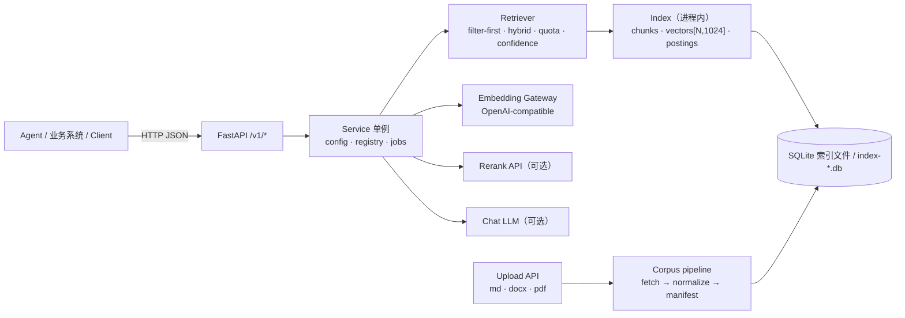
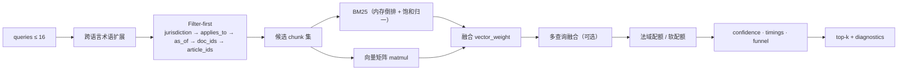
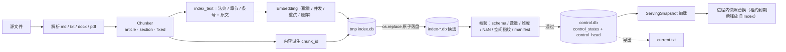
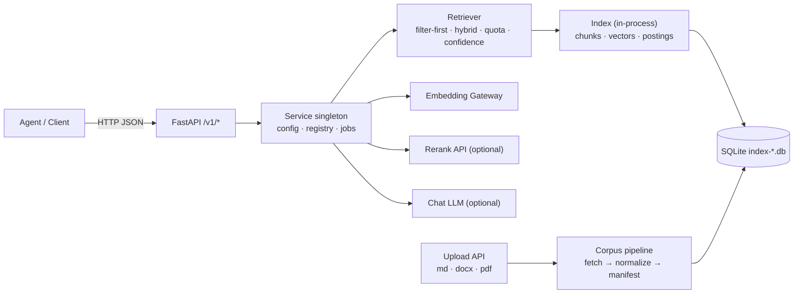

# 架构设计 / Architecture

> 本文是 Mercatoria 的架构说明。项目定位：**基于 RAGFlow 的后端实现**——沿用 RAGFlow
> `laws` 解析器的分块契约与知识库导入约定，检索、过滤、重排、引用、问答由本服务实现。
>
> **A RAGFlow-based backend implementation**: keeps RAGFlow's `laws` chunking contract and
> import conventions, and implements retrieval, filtering, reranking, citation and answer
> generation as a standalone service.

---

## 中文

### 1. 分层



| 层 | 组件 | 职责 |
|---|---|---|
| 接入层 | FastAPI（`mercatoria/api.py`） | 路由、参数校验、错误码；同步检索 + 异步 job |
| 服务层 | `Service`（单例） | 配置热更新、索引 reload、文档注册表、job 锁 |
| 检索层 | `Retriever`（`mercatoria/retrieve.py`） | 查询扩展、过滤漏斗、混合打分、配额、置信度、缓存 |
| 索引层 | `Index`（`mercatoria/store.py`） | 内存倒排 + 向量矩阵 + 条文聚合 + 交叉引用；加载完成后关闭 SQLite 连接 |
| 语料层 | `corpus/fetch_*.py`、`manifest.py` | 抓取、规整、生成 `manifest.json` |
| 评测层 | `tools/*.py`、`tests/*` | 消融、hold-out、覆盖率、profile、压测、fixture 审计 |

### 2. 检索流水线



1. **查询扩展**：224 条中英日贸易术语（182 中→英、42 中→日）。
2. **Filter-first**：`jurisdictions → applies_to → as_of → doc_ids → article_ids`，
   每一步数量写入 `diagnostics.funnel`；空集给出精确 `zero_reason`。
3. **双路召回**：内存倒排 BM25（饱和归一）与向量矩阵乘，按 `vector_weight` 融合。
4. **多查询融合**：同一 chunk 被多路命中时可加分（默认关闭，消融为负收益）。
5. **法域配额**：多法域请求为每个法域保留 `min(2, top_k // n)` 槽位；软配额按分数比例生效。
6. **置信度**：top-1 余弦 + 查询词 IDF 覆盖率 → `high|medium|low`，只读，不改结果。

### 3. 索引生命周期



- **唯一权威**：`control.db` 的 `control_head` 决定线上版本；`current.txt` 只是导出与迁移输入，重启也不读它做判断。
- **发布顺序**：构建候选 → 完整校验/加载 → `BEGIN IMMEDIATE` + CAS(base generation) 追加 generation 并移动 head → 替换进程内快照。校验或加载失败不移动 head，旧快照继续服务。
- **stage 与 activate 分离**：`activate=false` 只留候选文件，head、快照、`current.txt` 均不变，重启也不会自动激活。
- **请求级快照**：一个请求只有一个 `ServingSnapshot`（索引 + 冻结配置 + 检索器），发布中不会混用两个状态；旧快照在最后一个租约释放后关闭。
- **写入所有权**：`data/documents/write.lock` 是跨进程文件锁；第二个服务只读运行（`writable=false`，管理写操作 409），离线 CLI 检测到锁时拒绝写入。
- **schema 版本**：索引 `meta.schema_version=2`，control `PRAGMA user_version=1`；旧库自动回退，新库打开返回 503 并提示重建。
- **多版本共存**：`index-*.db` 全部保留，`POST /v1/admin/activate/{snapshot_version}` 回滚整个状态，`/v1/admin/indexes/{index_version}/activate` 发布已构建的候选。

### 4. 关键设计决策

| 决策 | 原因 | 可验证证据 |
|---|---|---|
| 内容派生 `chunk_id` | 引用可复现、重建可比对、缓存可复用 | `test_chunk_ids_are_stable_across_rebuild` |
| `index_text` 与 `text` 解耦 | 章节/法典名进入向量与 BM25，返回仍是原文 | 消融 A2：关闭 header 时真题 Hit@5 −1.7pp |
| Filter-first + 漏斗诊断 | 无命中时能证明是过滤空还是打分弱 | `zero_reason` 枚举失败阶段 |
| 内存倒排 + 关闭连接 | 消除跨线程 SQLite 竞争，查询路径零 SQL | BM25 p50 2.3 ms；连接关闭单测 |
| 查询向量 LRU + 持久化缓存 | 重复问题不打扰网关；线程安全 | 缓存命中 p50 0.24 ms；并发单测 |
| 配额前先扩池 | 配额只能提升第一阶段已召回的候选 | 覆盖率 1/8 → 8/8 |
| 置信度只读 | 下游需要可靠性信号，不应被改写候选 | no_answer 低置信率 0.83 |
| 评测与算法分提交 | 指标可归因 | A0/A1 消融：判分口径占 +2.04pp |
| schema 版本化 | 灰度重建期间新旧索引并存 | 旧库回退 + 新库 503 单测 |

### 5. 数据模型

**Chunk**

```
chunk_id        = sha256(doc_id | article_id | normalize(text))[:16]
doc_id          文档标识（manifest 或上传派生）
article_id      <doc_id>:<条号>，如 cn-customs-law-2021:55 / wto-dsu:art-17
article_label   人类可读条号（第五十五条 / § 101.1 / Article 17）
text            法规原文（多 part 时按 src_start/src_end 去重叠）
section         章节标题（索引头与展示）
part / ordinal  长条文分片序号 / 文档内总序
token_count     原文 token 数
index_token_count  索引文本 token 数（BM25 长度归一化）
```

**manifest 文档**：`doc_id`、`path`、`source_doc`、`jurisdiction`、`language`、
`precision`（`exact|degraded|snapshot`）、`applies_to[]`、`effective_from/to`、
`snapshot_date`、`superseded_by`。

**SQLite v2**：`docs`、`chunks`、`postings(term,chunk_id,tf)`、`terms(term,df)`、
`vectors(chunk_id,dim,vec)`、`meta`（`version`、`built_at`、`schema_version`、
`embedding_model`、`embedding_dim`、`chunking_hash`、`index_text_hash`、`avgdl`、`config`）。

**control.db**（`data/documents/`）：`control_states`（不可变 generation：`index_version`、
`manifest`、`manifest_id`、`build_profile_id`、`runtime_config_id`、`created_by_job_id`、
`created_at`）+ `control_head`（单行当前 generation）。**registry.db**：上传文档记录与状态，
逻辑删除用 `status=deleted` 表达。

---

## English

### 1. Layers



| Layer | Component | Responsibility |
|---|---|---|
| Edge | FastAPI (`mercatoria/api.py`) | routing, validation, status codes; sync retrieval + async jobs |
| Service | `Service` singleton | config hot-reload, index reload, document registry, job lock |
| Retrieval | `Retriever` | query expansion, filter funnel, hybrid scoring, quotas, confidence, caches |
| Index | `Index` | in-memory postings + vector matrix + article aggregation + references; SQLite closed after load |
| Corpus | `corpus/fetch_*.py`, `manifest.py` | fetch, normalise, derive `manifest.json` |
| Evaluation | `tools/*`, `tests/*` | ablation, hold-out, coverage, profiling, stress, fixture audit |

### 2. Retrieval pipeline

1. **Query expansion** — 224 trilingual trade terms (182 zh→en, 42 zh→ja).
2. **Filter-first** — `jurisdictions → applies_to → as_of → doc_ids → article_ids`, each step
   counted in `diagnostics.funnel`; an empty set yields a precise `zero_reason`.
3. **Dual recall** — BM25 over in-memory postings (saturated normalisation) and dense vector
   matmul, blended by `vector_weight`.
4. **Multi-query fusion** — optional bounded bonus (off by default; ablation negative).
5. **Jurisdiction quota** — `min(2, top_k // n)` slots per requested jurisdiction, softenable
   by `quota_min_ratio`.
6. **Confidence** — `high | medium | low` from the top-1 cosine and IDF-weighted query-term
   coverage; read-only, never reorders `chunks`.

### 3. Index lifecycle

New index → `*.tmp` → `os.replace` → candidate `index-*.db` → validation (schema, counts,
dimensions, NaN, embedding space, manifest) → append a generation in `control.db` and move the
single `control_head` row (CAS on the base generation) → load a `ServingSnapshot` and swap it in.

- The control head is the only authority. `current.txt` is an export and the migration input;
  no restart reads it to decide what serves.
- A candidate that fails validation or loading never moves the head: the old snapshot keeps serving.
- `activate=false` leaves a candidate file only; head, snapshot and `current.txt` are untouched.
- One snapshot per request (index + frozen config + retriever), so a publish cannot mix two states;
  a retired snapshot closes after its last lease.
- `data/documents/write.lock` is a cross-process lock: a second service serves reads only
  (`writable=false`, management writes 409) and an offline CLI refuses to write.
- `schema_version=2` for indexes, `PRAGMA user_version=1` for control; newer schemas are refused
  with a rebuild hint.
- All `index-*.db` files are kept: `activate/{snapshot_version}` rolls back a whole state,
  `indexes/{index_version}/activate` publishes an already built candidate.

### 4. Design decisions

| Decision | Why | Evidence |
|---|---|---|
| Content-addressed `chunk_id` | reproducible citations, comparable rebuilds, reusable caches | `test_chunk_ids_are_stable_across_rebuild` |
| `index_text` decoupled from `text` | chapter/statute names help recall without polluting the payload | ablation A2: trade Hit@5 −1.7pp when disabled |
| Filter-first with funnel diagnostics | prove whether a miss is filtering or scoring | `zero_reason` enumerates the failing stage |
| In-memory postings, closed connection | removes cross-thread SQLite races; zero SQL on the query path | BM25 p50 2.3 ms; connection-closed test |
| Query-vector LRU + persistent cache | repeat questions never hit the gateway; thread-safe | cache-hit p50 0.24 ms; concurrency test |
| Widen the pool before quota | a quota can only promote candidates the first stage offered | coverage 1/8 → 8/8 |
| Confidence is read-only | downstream needs a reliability signal, not a rewritten result | no_answer low rate 0.83 |
| Evaluation changes separate from algorithm changes | metrics stay attributable | A0/A1: scoring = +2.04pp |

### 5. Data model

- **Chunk**: `chunk_id = sha256(doc_id | article_id | normalize(text))[:16]`; `article_id`
  `<doc_id>:<number>`; `text` raw; `section`, `part`, `ordinal`, `token_count`,
  `index_token_count`.
- **Manifest document**: `doc_id`, `path`, `source_doc`, `jurisdiction`, `language`,
  `precision`, `applies_to`, `effective_from/to`, `snapshot_date`, `superseded_by`.
- **SQLite v2**: `docs`, `chunks`, `postings`, `terms`, `vectors`, `meta`
  (`schema_version`, `chunking_hash`, `index_text_hash`, …).
- **`control.db`** (`data/documents/`): immutable `control_states` rows (`index_version`,
  `manifest`, `manifest_id`, `build_profile_id`, `runtime_config_id`, `created_by_job_id`,
  `created_at`) plus the single-row `control_head`. **`registry.db`** holds uploaded document
  records; a logical delete is `status=deleted`.
