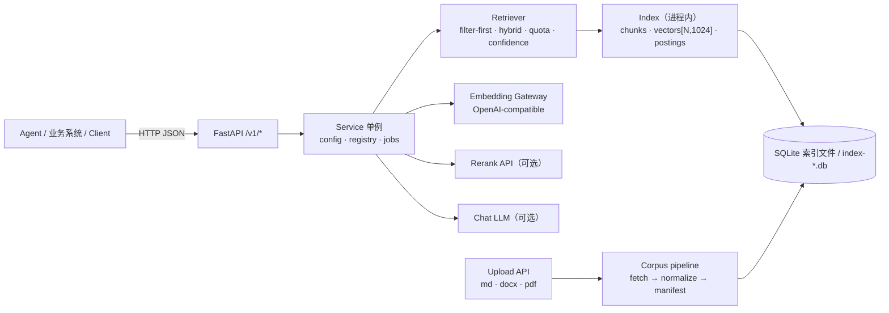
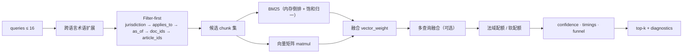
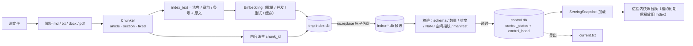
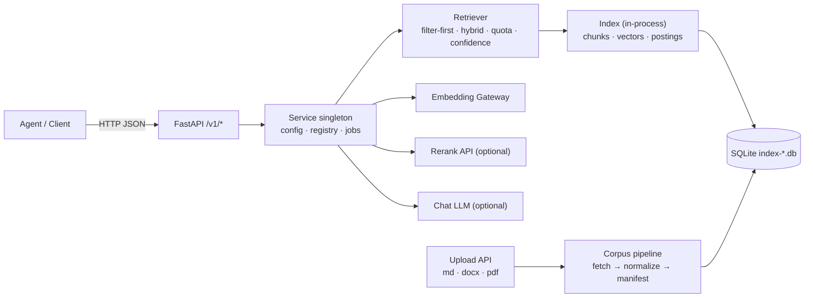

# 架构设计 / Architecture

> 本文是 Mercatoria 的架构说明。项目定位：**基于 RAGFlow 的后端实现**——沿用 RAGFlow
> `laws` 解析器的分块契约与知识库导入约定，检索、过滤、重排、引用、问答由本服务实现。
>
> **A RAGFlow-based backend implementation**: keeps RAGFlow's `laws` chunking contract and
> import conventions, and implements retrieval, filtering, reranking, citation and answer
> generation as a standalone service.

---

## 中文

### 1. 分层



| 层 | 组件 | 职责 |
|---|---|---|
| 接入层 | FastAPI（`mercatoria/api.py`） | 路由、参数校验、错误码；同步检索 + 异步 job |
| 服务层 | `Service`（单例） | 配置热更新、索引 reload、文档注册表、job 锁 |
| 检索层 | `Retriever`（`mercatoria/retrieve.py`） | 查询扩展、过滤漏斗、混合打分、配额、置信度、缓存 |
| 索引层 | `Index`（`mercatoria/store.py`） | 内存倒排 + 向量矩阵 + 条文聚合 + 交叉引用；加载完成后关闭 SQLite 连接 |
| 语料层 | `corpus/fetch_*.py`、`manifest.py` | 抓取、规整、生成 `manifest.json` |
| 评测层 | `tools/*.py`、`tests/*` | 消融、hold-out、覆盖率、profile、压测、fixture 审计 |

### 2. 检索流水线



1. **查询扩展**：224 条中英日贸易术语（182 中→英、42 中→日）。
2. **Filter-first**：`jurisdictions → applies_to → as_of → doc_ids → article_ids`，
   每一步数量写入 `diagnostics.funnel`；空集给出精确 `zero_reason`。
3. **双路召回**：内存倒排 BM25（饱和归一）与向量矩阵乘，按 `vector_weight` 融合。
4. **多查询融合**：同一 chunk 被多路命中时可加分（默认关闭，消融为负收益）。
5. **法域配额**：多法域请求为每个法域保留 `min(2, top_k // n)` 槽位；软配额按分数比例生效。
6. **置信度**：top-1 余弦 + 查询词 IDF 覆盖率 → `high|medium|low`，只读，不改结果。

### 3. 索引生命周期



- **唯一权威**：`control.db` 的 `control_head` 决定线上版本；`current.txt` 只是导出与迁移输入，重启也不读它做判断。
- **发布顺序**：构建候选 → **提交前**完整校验并构造客户端（`prepare`）→ `BEGIN IMMEDIATE` + CAS(base generation) 追加 generation 并移动 head → 导出 `current.txt` → 替换进程内快照。
  提交前失败不动 head；导出失败只记 warning；提交后安装失败按 `not-ready` 处理，不做"未提交"回滚。
- **stage 与 activate 分离**：`activate=false` 只留候选文件，head、快照、`current.txt` 均不变，重启也不会自动激活。
  迁移只认显式 `current.txt` 指针：没有指针即 `not_built`，指针损坏 fail closed，已有 head 后该文件不参与判断。
- **候选自描述**：每次 build 在索引内记录自己的 manifest、build 配置与 base generation；激活读取该记录并 CAS 该 base。
  记录缺失/缺 base 字段/manifest 无效一律 409，不借当前 head 补 base；旧状态恢复走 snapshot rollback。
- **请求级快照**：一个请求只有一个 `ServingSnapshot`（索引 + 冻结配置 + 检索器），发布中不会混用两个状态；旧快照在最后一个租约释放后关闭。
- **数据就绪门**：证据读取（retrieve/chat/articles/chunks）在短发布门内确认"已提交 head == 在线快照"并一次性 pin 住，
  再释放门去执行 embedding/LLM；不一致先确定性 reload，仍失败返回 503。提交前已 pin 的请求可用旧快照完成。
- **并发安装保护**：加载可在发布门之外进行，安装前在锁内复核 head；过期快照被丢弃并关闭，`SnapshotHolder` 拒绝安装更旧的 generation。
- **管理互斥**：config、rebuild、ingest、delete、metadata、reindex、候选激活、rollback 由唯一管理 token 串行化；
  后台任务在入口接纳时取得 token、终态释放（跨线程，因此不是 RLock）。忙时其它管理写 409，且不先改 cfg/desired。
  受控快照同时提供 build 配置与 base generation，避免"旧 cfg + 新 base"。
- **写入所有权**：`data/documents/write.lock` 是跨进程文件锁，在打开 control/registry 之前获取；拿不到锁的第二个实例直接启动失败（不再提供"只读副本"），离线 CLI 检测到锁时拒绝写入。
- **配置持久化**：control state 记录该 generation 的非敏感配置，`desired_config` 单行表记录运维意图；
  runtime 发布与该次接受的 desired 在同一个控制事务内提交（不会 head 前进而意图落后）。
  部署路径/限额/凭证始终来自部署环境（config.json + env），`save=true` 只额外原子导出完整的无密钥部署文件。
  重启后同一 `snapshot_version` 绑定同一配置。
- **提交后收尾**：commit 之后的 export、最终 progress、chunk 统计、registry 投影失败都只记 `warnings`（或带 committed 的
  `PostCommitError`），不触发提交前补偿；job 结果记录 `committed` 与版本，投影可由下一次发布修复。
- **embedding 空间身份**：`embedding_space_id` 覆盖 provider/端点/model/显式 revision/space_version/dim/预处理版本；
  索引 meta 记录该 id，跨空间不复用向量；持久缓存表 `embeddings_by_space` 以 space_id 为键。timeout/重试/凭证不在身份内。
- **schema 版本**：索引 `meta.schema_version=2`，control `PRAGMA user_version=2`；旧库自动回退，新库打开返回 503 并提示重建。
- **多版本共存**：`index-*.db` 全部保留，`POST /v1/admin/activate/{snapshot_version}` 回滚整个状态（索引 + manifest + 该代配置），`/v1/admin/indexes/{index_version}/activate` 发布已构建的候选。

### 4. 关键设计决策

| 决策 | 原因 | 可验证证据 |
|---|---|---|
| 内容派生 `chunk_id` | 引用可复现、重建可比对、缓存可复用 | `test_chunk_ids_are_stable_across_rebuild` |
| `index_text` 与 `text` 解耦 | 章节/法典名进入向量与 BM25，返回仍是原文 | 消融 A2：关闭 header 时真题 Hit@5 −1.7pp |
| Filter-first + 漏斗诊断 | 无命中时能证明是过滤空还是打分弱 | `zero_reason` 枚举失败阶段 |
| 内存倒排 + 关闭连接 | 消除跨线程 SQLite 竞争，查询路径零 SQL | BM25 p50 2.3 ms；连接关闭单测 |
| 查询向量 LRU + 持久化缓存 | 重复问题不打扰网关；线程安全 | 缓存命中 p50 0.24 ms；并发单测 |
| 配额前先扩池 | 配额只能提升第一阶段已召回的候选 | 覆盖率 1/8 → 8/8 |
| 置信度只读 | 下游需要可靠性信号，不应被改写候选 | no_answer 低置信率 0.83 |
| 评测与算法分提交 | 指标可归因 | A0/A1 消融：判分口径占 +2.04pp |
| schema 版本化 | 灰度重建期间新旧索引并存 | 旧库回退 + 新库 503 单测 |

### 5. 数据模型

**Chunk**

```
chunk_id        = sha256(doc_id | article_id | normalize(text))[:16]
doc_id          文档标识（manifest 或上传派生）
article_id      <doc_id>:<条号>，如 cn-customs-law-2021:55 / wto-dsu:art-17
article_label   人类可读条号（第五十五条 / § 101.1 / Article 17）
text            法规原文（多 part 时按 src_start/src_end 去重叠）
section         章节标题（索引头与展示）
part / ordinal  长条文分片序号 / 文档内总序
token_count     原文 token 数
index_token_count  索引文本 token 数（BM25 长度归一化）
```

**manifest 文档**：`doc_id`、`path`、`source_doc`、`jurisdiction`、`language`、
`precision`（`exact|degraded|snapshot`）、`applies_to[]`、`effective_from/to`、
`snapshot_date`、`superseded_by`。

**SQLite v2**：`docs`、`chunks`、`postings(term,chunk_id,tf)`、`terms(term,df)`、
`vectors(chunk_id,dim,vec)`、`meta`（`version`、`built_at`、`schema_version`、
`embedding_model`、`embedding_dim`、`chunking_hash`、`index_text_hash`、`avgdl`、`config`、
`candidate={manifest, base_generation}`）。`vectors` 与 `chunks` 按 `chunk_id` 逐条对齐，
缺失/多余/错 ID/维度不符在打开索引时即拒绝。

**control.db**（`data/documents/`）：`control_states`（不可变 generation：`index_version`、
`manifest`、`manifest_id`、`build_profile_id`、`runtime_config_id`、`config`、
`created_by_job_id`、`created_at`）+ `control_head`（单行当前 generation）+
`desired_config`（单行，运维期望的配置，可含尚未重建的 build 变更）。
**registry.db**：上传文档记录与状态，逻辑删除用 `status=deleted` 表达。

### 6. 迁移与兼容（control schema 1 → 2）

- 启动时按 `PRAGMA user_version` 做**加性**迁移：`control_states.config` 列与 `desired_config` 表，
  事务内完成，失败回滚；重复执行幂等。迁移不复制 `current.txt` 指向的索引以外的文件。
- 旧 generation（`config` 为空）只能按 `runtime_config_id` 校验：部署配置指纹一致则按部署配置服务，
  不一致则拒绝加载并提示 rebuild/rollback，不猜历史配置。新发布都会写入 `config`。
- 旧版配置中的 `save=false` 更新从未持久化，无法事后恢复：升级后同版本号可能继续反映旧值，
  下一次 PUT 会写入持久配置。`save` 字段仍被接受，但不再影响是否持久化。
- 旧索引若无 `meta.config`，`embedding.base` 无法核对（只校验 model/dim/chunking）；建议重建。
- `embedding_space_id` 是本轮新增的索引 meta。没有该 id 的旧索引不会被复用向量（重建时重新 embedding），
  也不会做空间一致性校验（仍校验 model/dim/index 记录的 base）。
- 持久缓存迁移：新的 `embeddings_by_space(space_id, text_hash, dim, vec)` 表独立于旧的 `embeddings(model, …)` 表。
  旧行没有可信空间标识，**不再读取**；删除 embedding cache 文件可回收空间，下一次重建会重新填充。
- 只改 `embedding.timeout/retries/api_key` 不改变 space id，向量与缓存继续复用；改 base/model/dim/revision/space_version 必须重建。
- 回滚说明：`POST /v1/admin/activate/{snapshot_version}` 追加新 generation 并恢复该代索引、manifest 与配置；
  仅当目标索引文件与配置仍可用时成功，否则 409。候选激活要求候选自身记录完整，否则 409。
- 备份：`data/documents/control.db`（WAL 请用一致性备份）、`data/documents/registry.db`、
  `data/index/`；恢复后以 control head 为准，`current.txt` 可重新导出。

---

## English

### 1. Layers



| Layer | Component | Responsibility |
|---|---|---|
| Edge | FastAPI (`mercatoria/api.py`) | routing, validation, status codes; sync retrieval + async jobs |
| Service | `Service` singleton | config hot-reload, index reload, document registry, job lock |
| Retrieval | `Retriever` | query expansion, filter funnel, hybrid scoring, quotas, confidence, caches |
| Index | `Index` | in-memory postings + vector matrix + article aggregation + references; SQLite closed after load |
| Corpus | `corpus/fetch_*.py`, `manifest.py` | fetch, normalise, derive `manifest.json` |
| Evaluation | `tools/*`, `tests/*` | ablation, hold-out, coverage, profiling, stress, fixture audit |

### 2. Retrieval pipeline

1. **Query expansion** — 224 trilingual trade terms (182 zh→en, 42 zh→ja).
2. **Filter-first** — `jurisdictions → applies_to → as_of → doc_ids → article_ids`, each step
   counted in `diagnostics.funnel`; an empty set yields a precise `zero_reason`.
3. **Dual recall** — BM25 over in-memory postings (saturated normalisation) and dense vector
   matmul, blended by `vector_weight`.
4. **Multi-query fusion** — optional bounded bonus (off by default; ablation negative).
5. **Jurisdiction quota** — `min(2, top_k // n)` slots per requested jurisdiction, softenable
   by `quota_min_ratio`.
6. **Confidence** — `high | medium | low` from the top-1 cosine and IDF-weighted query-term
   coverage; read-only, never reorders `chunks`.

### 3. Index lifecycle

New index → `*.tmp` → `os.replace` → candidate `index-*.db` → **prepare** before the commit (open,
validate schema/counts/id alignment/dimensions/NaN/space/manifest, construct the clients) → append a
generation in `control.db` and move the single `control_head` row (CAS on the base generation) →
export `current.txt` → load a `ServingSnapshot` and swap it in.

- The control head is the only authority. `current.txt` is an export and the migration input;
  no restart reads it to decide what serves. Migration accepts only an explicit pointer: no pointer
  means `not_built`, a broken pointer fails closed, and an existing head ignores the file entirely.
- A candidate that fails validation or loading never moves the head: the old snapshot keeps serving.
- `activate=false` leaves a candidate file only; head, snapshot and `current.txt` are untouched.
  Each build records its own manifest, build config and base generation, and activation uses that
  record (an expired base returns 409). A candidate without a record, without `base_generation`, or
  with an invalid manifest is refused with 409 — the current head is never borrowed as a base.
- After the commit, an export failure is a warning and an install failure is `not_ready`
  (`PostCommitError`, `result.committed=true`); neither is ever compensated as "not committed".
  Final progress, chunk counts and the registry projection are post-commit too: they append
  warnings to the job result instead of failing the rebuild.
- One snapshot per request (index + frozen config + retriever), so a publish cannot mix two states;
  a retired snapshot closes after its last lease.
- Evidence reads confirm "committed head == online snapshot" and pin that snapshot inside the short
  publication gate, then release the gate for the actual work; a mismatch reloads once and then
  answers 503. A request that already holds a lease finishes on the old snapshot.
- Management writes are serialized by one token (config, rebuild, ingest, delete, metadata,
  reindex, activation, rollback). The token is taken at admission and released at completion
  (possibly from the worker thread), so a concurrent management write gets 409 without first
  changing config or desired state. Build config and base generation come from the same controlled
  snapshot.
- Loading runs outside the publication gate; installing re-checks the head under it, and the holder
  refuses an older generation, so a slow reload cannot move the process backwards.
- `data/documents/write.lock` is a cross-process lock taken before any writable store is opened:
  a second instance fails to start instead of serving a head it never follows, and an offline CLI
  refuses to write.
- Control states persist the non-sensitive config they serve with; `desired_config` holds the
  operator's intent, and a runtime publication commits both in one control transaction. Deployment
  paths, limits and credentials stay in the environment; `save=true` additionally exports the full
  deployment file (no credentials) atomically.
- `embedding_space_id` (provider/endpoint/model/revision/space_version/dim/preprocessing) gates
  vector reuse and keys the persistent `embeddings_by_space` cache; timeout, retries and credentials
  are outside it.
- `schema_version=2` for indexes, `PRAGMA user_version=2` for control; newer schemas are refused
  with a rebuild hint.
- All `index-*.db` files are kept: `activate/{snapshot_version}` rolls back a whole state,
  `indexes/{index_version}/activate` publishes an already built candidate.

### 4. Design decisions

| Decision | Why | Evidence |
|---|---|---|
| Content-addressed `chunk_id` | reproducible citations, comparable rebuilds, reusable caches | `test_chunk_ids_are_stable_across_rebuild` |
| `index_text` decoupled from `text` | chapter/statute names help recall without polluting the payload | ablation A2: trade Hit@5 −1.7pp when disabled |
| Filter-first with funnel diagnostics | prove whether a miss is filtering or scoring | `zero_reason` enumerates the failing stage |
| In-memory postings, closed connection | removes cross-thread SQLite races; zero SQL on the query path | BM25 p50 2.3 ms; connection-closed test |
| Query-vector LRU + persistent cache | repeat questions never hit the gateway; thread-safe | cache-hit p50 0.24 ms; concurrency test |
| Widen the pool before quota | a quota can only promote candidates the first stage offered | coverage 1/8 → 8/8 |
| Confidence is read-only | downstream needs a reliability signal, not a rewritten result | no_answer low rate 0.83 |
| Evaluation changes separate from algorithm changes | metrics stay attributable | A0/A1: scoring = +2.04pp |

### 5. Data model

- **Chunk**: `chunk_id = sha256(doc_id | article_id | normalize(text))[:16]`; `article_id`
  `<doc_id>:<number>`; `text` raw; `section`, `part`, `ordinal`, `token_count`,
  `index_token_count`.
- **Manifest document**: `doc_id`, `path`, `source_doc`, `jurisdiction`, `language`,
  `precision`, `applies_to`, `effective_from/to`, `snapshot_date`, `superseded_by`.
- **SQLite v2**: `docs`, `chunks`, `postings`, `terms`, `vectors`, `meta`
  (`schema_version`, `chunking_hash`, `index_text_hash`, `config`,
  `candidate={manifest, base_generation}`, …). `vectors` are matched to `chunks` by exact
  `chunk_id`; missing, extra, wrong-id or differently sized rows refuse the index at open time.
- **`control.db`** (`data/documents/`): immutable `control_states` rows (`index_version`,
  `manifest`, `manifest_id`, `build_profile_id`, `runtime_config_id`, `config`,
  `created_by_job_id`, `created_at`), the single-row `control_head`, and a single-row
  `desired_config` holding the operator's (possibly not yet built) intent. **`registry.db`**
  holds uploaded document records; a logical delete is `status=deleted`.

### 6. Migration and compatibility (control schema 1 → 2)

- Startup runs an **additive** migration inside a transaction: the `control_states.config` column
  and the `desired_config` table. It is idempotent and rolls back on failure; no index file is
  copied or rewritten.
- A pre-v2 generation (empty `config`) is accepted only while the deployment config's runtime
  fingerprint still equals its recorded `runtime_config_id`; otherwise loading fails with an
  explicit rebuild/rollback hint rather than guessing the historical config. Every new publication
  writes `config`.
- `save=false` updates were never persisted before this change and cannot be reconstructed: the
  same `snapshot_version` may still reflect the older value until the next PUT persists. `save` is
  still accepted but no longer decides whether an update survives a restart.
- An index without `meta.config` cannot prove its `embedding.base` (only model/dim/chunking are
  checked); rebuild it to gain the endpoint check.
- `embedding_space_id` is new index metadata. An index without it never has its vectors reused
  (the rebuild re-embeds) and gets no space check beyond model/dim/recorded base.
- Persistent cache migration: `embeddings_by_space(space_id, text_hash, dim, vec)` is separate from
  the old `embeddings(model, …)` table. Old rows have no trustworthy space identity and are never
  read; deleting the cache file reclaims them and a rebuild repopulates it.
- Changing only `embedding.timeout/retries/api_key` keeps the space id, so vectors and cache entries
  stay valid; changing base/model/dim/revision/space_version requires a rebuild.
- Rollback: `POST /v1/admin/activate/{snapshot_version}` appends a generation restoring that
  index, manifest and config; it succeeds only while the target index and config remain usable
  (otherwise 409). Candidate activation requires the candidate's own record (otherwise 409).
- Backup set: `data/documents/control.db` (use a consistent WAL backup), `data/documents/registry.db`
  and `data/index/`. After restore the control head is authoritative and `current.txt` can be
  re-exported.
